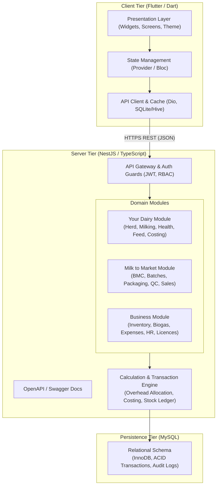
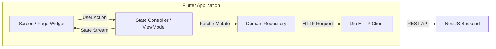

# Dairy Farm Management System - System Architecture Document

## 1. Architectural Overview

The Dairy Farm Management System is engineered as a robust, layered, two-tier client-server solution:
1. **Client Tier:** A cross-platform mobile application developed with **Flutter & Dart**, targeting Android smartphones (compact to large screens) and tablets, with accessibility and responsive layouts.
2. **Server Tier:** A modular, scalable REST API server developed with **Node.js, NestJS, and TypeScript**, adhering to Clean Architecture principles.
3. **Persistence Tier:** A relational **MySQL** database enforcing transactional integrity, foreign key constraints, and indexed audit logs.



---

## 2. Server Architecture (NestJS / TypeScript)

### 2.1 Modular Structure
The NestJS application is organized into high-cohesion, low-coupling domain modules mapping directly to the verified business boundaries:

```
src/
├── app.module.ts
├── main.ts
├── common/
│   ├── decorators/          # @CurrentUser(), @Roles(), @Public()
│   ├── dto/                 # Base pagination, date range, response envelope
│   ├── filters/             # AllExceptionsFilter, HttpExceptionFilter
│   ├── guards/              # JwtAuthGuard, RolesGuard
│   ├── interceptors/        # LoggingInterceptor, TransformInterceptor
│   └── pipes/               # CustomValidationPipe, ParseDatePipe
├── config/                  # Configuration service and environment validation
├── database/                # TypeORM / Prisma configuration & migrations
├── modules/
│   ├── auth/                # JWT issuance, login, refresh, password hashing
│   ├── users/               # User accounts, role assignment, permissions
│   ├── dairy/
│   │   ├── herd/            # Cattle registration, lineage, lifecycle
│   │   ├── milking/         # Session milking, withdrawal checks
│   │   ├── health/          # Veterinary records, vaccines, withdrawal periods
│   │   ├── breeding/        # AI, heat cycles, pregnancy checks
│   │   ├── feed/            # Concentrate rule engine, feed logs
│   │   └── costing/         # Daily farm cost per litre computation
│   ├── market/
│   │   ├── bmc/             # Tank ledger, farm & external intake
│   │   ├── production/      # Batches, milk & fuel consumption, by-products
│   │   ├── packaging/       # Packaging runs, material deduction
│   │   ├── quality/         # Inspection records, release gates
│   │   ├── materials/       # Consumable issues to cost centres
│   │   ├── electricity/     # Meter readings, default fallback engine
│   │   ├── orders/          # Sales orders, booking status
│   │   ├── sales/           # Dispatches, invoice creation, pack reduction
│   │   └── payments/        # Accounts receivable receipts
│   └── business/
│       ├── inventory/       # Stock ledger, receipts, average cost
│       ├── biogas/          # Digestate drying, bagging, cost allocation
│       ├── wastage/         # Loss reporting across all stock types
│       ├── expenses/        # Operational costs & expenses ledger
│       ├── employees/       # Staff directory, daily payroll allocation
│       ├── licences/        # FSSAI compliance, expiry reminders
│       ├── reports/         # CSV exporters, JSON backup engine
│       └── settings/        # Master farm parameters
```

### 2.2 Transaction & Consistency Management
All operations modifying inventory, balances, or financial allocations execute within **atomic database transactions** (`QueryRunner` / `$transaction`):
- **Milk Intake Acceptance:** Inserts intake record + updates BMC tank ledger balance.
- **Production Batch Creation:** Deducts BMC milk + deducts LPG inventory + creates production batch record.
- **Packaging Run:** Deducts bulk production batch balance + deducts packaging stock items (pouches, labels, cartons) + creates packaged stock units.
- **Sales Dispatch:** Deducts packaged stock + records sale + creates initial accounts receivable balance.

---

## 3. Client Architecture (Flutter / Dart)

### 3.1 Design Principles & State Management
- **Framework:** Flutter 3.x with Dart 3.x.
- **State Management:** Provider / BLoC pattern for predictable unidirectional data flow.
- **Networking:** `Dio` client configured with:
  - Auth interceptor for JWT injection and token refresh.
  - Standard error handling transforming backend HTTP exceptions into user-friendly error banners.
  - Exponential backoff retry for network connectivity drops.
- **Theme & Presentation:**
  - Strict adherence to light-themed design tokens (forest green primary, soft neutrals, clear semantic colors for statuses).
  - Component library: reusable forms, responsive tables, KPI cards, date pickers, filter bars, and modal dialogs.
  - Layout adapts automatically to phones (single-column card lists) and tablets (two-column split views and side navigation).



---

## 4. Security & Compliance Architecture

1. **Authentication:**
   - Stateless JWT tokens signed with HMAC SHA-256 or RSA.
   - Access tokens with standard short TTL (e.g. 1 hour) and secure refresh tokens.
   - Passwords hashed with `bcrypt` (work factor 12).
2. **Authorization (RBAC):**
   - Every protected route enforces `@UseGuards(JwtAuthGuard, RolesGuard)`.
   - Granular role checks match the 11 logical roles defined in the specification.
3. **Data Integrity & Audit:**
   - Every mutation table stores `created_at`, `updated_at`, and `created_by_user_id`.
   - Sensitive calculations (unit costs, inventory deductions) cannot be manipulated by client-side payloads; all formulas are executed exclusively by the server-side business engine.
4. **Environment Security:**
   - Zero credentials committed to version control.
   - Strict validation of environment variables on backend boot via `@nestjs/config` and `Joi`/`Zod`.
