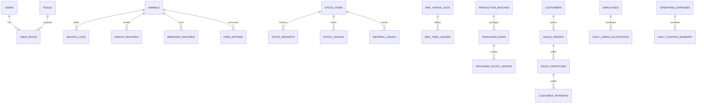

# Dairy Farm Management System - Database Design Specification

## 1. Schema Overview

The database uses **MySQL 8.0+** with the **InnoDB** storage engine, `utf8mb4_unicode_ci` character set, and strict ACID transaction semantics. The schema models all 24 business modules, ensuring referential integrity, double-entry stock reconciliation, and auditable historical records.

---

## 2. Table Definitions & Data Dictionary

### 2.1 Identity & Access Management

#### `users`
| Column | Type | Constraints | Description |
| :--- | :--- | :--- | :--- |
| `id` | VARCHAR(36) | PK, UUID | Unique user identifier |
| `email` | VARCHAR(120) | UNIQUE, NOT NULL | Login identity / email |
| `password_hash` | VARCHAR(255) | NOT NULL | Bcrypt hash |
| `full_name` | VARCHAR(100) | NOT NULL | User's full name |
| `phone` | VARCHAR(20) | NULL | Contact phone number |
| `is_active` | BOOLEAN | DEFAULT TRUE | Account active status |
| `created_at` | DATETIME | DEFAULT CURRENT_TIMESTAMP | Timestamp |
| `updated_at` | DATETIME | DEFAULT CURRENT_TIMESTAMP ON UPDATE CURRENT_TIMESTAMP | Timestamp |

#### `roles`
| Column | Type | Constraints | Description |
| :--- | :--- | :--- | :--- |
| `id` | VARCHAR(36) | PK | Unique role identifier |
| `code` | VARCHAR(50) | UNIQUE, NOT NULL | e.g. `FARM_OWNER`, `FARM_MANAGER`, `ANIMAL_CARE`, `ACCOUNTANT` |
| `name` | VARCHAR(100) | NOT NULL | Human readable title |
| `description` | TEXT | NULL | Scope summary |

#### `user_roles`
| Column | Type | Constraints | Description |
| :--- | :--- | :--- | :--- |
| `user_id` | VARCHAR(36) | FK -> `users.id`, PK | User identifier |
| `role_id` | VARCHAR(36) | FK -> `roles.id`, PK | Role identifier |

---

### 2.2 Domain A: Your Dairy (Herd & Farm Operations)

#### `animals`
| Column | Type | Constraints | Description |
| :--- | :--- | :--- | :--- |
| `id` | VARCHAR(36) | PK, UUID | Animal primary key |
| `ear_tag` | VARCHAR(50) | UNIQUE, NOT NULL | Physical ear tag / RFID code |
| `name` | VARCHAR(100) | NULL | Name of animal (e.g. "Ganga") |
| `breed` | VARCHAR(50) | NOT NULL | e.g. "HF", "Jersey", "Gir", "Murrah" |
| `sex` | ENUM('FEMALE', 'MALE') | NOT NULL | Sex |
| `date_of_birth` | DATE | NULL | Date of birth |
| `status` | ENUM('LACTATING', 'DRY', 'PREGNANT', 'HEIFER', 'CALF', 'BULL', 'SOLD', 'DECEASED') | NOT NULL | Current lifecycle status |
| `body_weight_kg` | DECIMAL(6,2) | NULL | Live weight |
| `dam_tag` | VARCHAR(50) | NULL | Mother ear tag |
| `last_calving_date` | DATE | NULL | Date of most recent calving |
| `body_condition_score` | DECIMAL(3,1) | NULL | Score (1.0 to 5.0) |
| `notes` | TEXT | NULL | Additional observation notes |
| `created_at` | DATETIME | DEFAULT CURRENT_TIMESTAMP | Audit timestamp |

#### `milking_logs`
| Column | Type | Constraints | Description |
| :--- | :--- | :--- | :--- |
| `id` | VARCHAR(36) | PK, UUID | Record ID |
| `animal_id` | VARCHAR(36) | FK -> `animals.id`, NOT NULL | Cow reference |
| `record_date` | DATE | NOT NULL, INDEX | Milking date |
| `session` | ENUM('MORNING', 'EVENING') | NOT NULL | Milking shift |
| `yield_litres` | DECIMAL(6,2) | NOT NULL | Volume milked in litres |
| `disposition` | ENUM('ELIGIBLE', 'WITHHELD', 'CALF_FEEDING') | NOT NULL | Eligibility for collection pool |
| `withheld_reason` | VARCHAR(255) | NULL | Stated reason if withheld |
| `notes` | TEXT | NULL | Shift observations |
| `created_by` | VARCHAR(36) | FK -> `users.id` | User who logged record |

#### `health_records`
| Column | Type | Constraints | Description |
| :--- | :--- | :--- | :--- |
| `id` | VARCHAR(36) | PK, UUID | Record ID |
| `animal_id` | VARCHAR(36) | FK -> `animals.id`, NOT NULL | Animal reference |
| `record_date` | DATE | NOT NULL | Date care administered |
| `care_type` | ENUM('TREATMENT', 'VACCINATION', 'DEWORMING', 'EXAMINATION') | NOT NULL | Type of intervention |
| `medicine_vaccine` | VARCHAR(120) | NOT NULL | Product administered |
| `prescribed_dose` | VARCHAR(100) | NOT NULL | Dosage instructions |
| `veterinarian` | VARCHAR(100) | NULL | Vet name |
| `next_due_date` | DATE | NULL | Next scheduled booster/follow-up |
| `withdrawal_until` | DATE | NULL | Date until which milk must be withheld |
| `stock_item_id` | VARCHAR(36) | FK -> `stock_items.id`, NULL | Inventory item linked |
| `stock_qty_used` | DECIMAL(8,2) | NULL | Quantity deducted from inventory |
| `notes` | TEXT | NULL | Clinical observations |

#### `breeding_records`
| Column | Type | Constraints | Description |
| :--- | :--- | :--- | :--- |
| `id` | VARCHAR(36) | PK, UUID | Record ID |
| `animal_id` | VARCHAR(36) | FK -> `animals.id`, NOT NULL | Cow reference |
| `record_date` | DATE | NOT NULL | Date event observed |
| `event_type` | ENUM('HEAT', 'INSEMINATION', 'PREGNANCY_CONFIRMED', 'PREGNANCY_CHECK', 'CALVING', 'DRY_OFF') | NOT NULL | Lifecycle event |
| `sire_semen_id` | VARCHAR(100) | NULL | Semen straw/bull tag |
| `expected_calving_date` | DATE | NULL | Computed/recorded expected calving |
| `calf_tag` | VARCHAR(50) | NULL | Resulting calf tag |
| `notes` | TEXT | NULL | Details |

#### `feed_entries`
| Column | Type | Constraints | Description |
| :--- | :--- | :--- | :--- |
| `id` | VARCHAR(36) | PK, UUID | Record ID |
| `animal_id` | VARCHAR(36) | FK -> `animals.id`, NOT NULL | Target cow |
| `record_date` | DATE | NOT NULL | Issue date |
| `stock_item_id` | VARCHAR(36) | FK -> `stock_items.id`, NOT NULL | Feed inventory item |
| `quantity_kg` | DECIMAL(8,2) | NOT NULL | Quantity issued |
| `feed_type` | ENUM('CONCENTRATE', 'GREEN_FODDER', 'DRY_FODDER', 'MINERAL_MIXTURE', 'SALT', 'MAIZE', 'CALF_STARTER') | NOT NULL | Nutritional category |
| `notes` | TEXT | NULL | Notes |

---

### 2.3 Domain B: Milk to Market (Processing & Commercial)

#### `bmc_intake_logs`
| Column | Type | Constraints | Description |
| :--- | :--- | :--- | :--- |
| `id` | VARCHAR(36) | PK, UUID | Intake ID |
| `batch_number` | VARCHAR(50) | UNIQUE, NOT NULL | e.g. `KD-IN-20261001-0001` |
| `record_date` | DATE | NOT NULL | Intake date |
| `source` | ENUM('FARM', 'EXTERNAL') | NOT NULL | Origin of milk |
| `supplier_route` | VARCHAR(120) | NULL | Route or supplier name |
| `quantity_litres` | DECIMAL(8,2) | NOT NULL | Intake volume |
| `external_total_cost` | DECIMAL(10,2) | DEFAULT 0.00 | Cost if bought externally |
| `decision` | ENUM('ACCEPTED', 'REJECTED') | NOT NULL | QC gate decision |
| `temperature_c` | DECIMAL(4,1) | NULL | Milk temperature (°C) |
| `fat_percentage` | DECIMAL(4,2) | NULL | Measured Fat % |
| `snf_percentage` | DECIMAL(4,2) | NULL | Measured Solids-Not-Fat % |
| `clr` | DECIMAL(5,2) | NULL | Corrected Lactometer Reading |
| `ph` | DECIMAL(3,2) | NULL | Acidity measurement |
| `quality_notes` | TEXT | NULL | Organoleptic or adulteration notes |

#### `production_batches`
| Column | Type | Constraints | Description |
| :--- | :--- | :--- | :--- |
| `id` | VARCHAR(36) | PK, UUID | Batch ID |
| `batch_number` | VARCHAR(50) | UNIQUE, NOT NULL | Batch reference code |
| `record_date` | DATE | NOT NULL | Batch production date |
| `product_type` | ENUM('MILK', 'PANEER', 'KHOYA', 'GHEE', 'DAHI', 'BUTTER', 'BIOGAS_FERTILISER') | NOT NULL | Output product |
| `bmc_milk_consumed_l` | DECIMAL(8,2) | NOT NULL | Raw milk used from BMC |
| `finished_quantity` | DECIMAL(8,2) | NOT NULL | Output volume (L) or weight (kg) |
| `unit_of_measure` | ENUM('LITRE', 'KG') | NOT NULL | Output unit |
| `lpg_stock_item_id` | VARCHAR(36) | FK -> `stock_items.id`, NULL | LPG cylinder stock item |
| `lpg_used_kg` | DECIMAL(6,2) | DEFAULT 0.00 | Fuel weight consumed |
| `byproduct_quantity_kg` | DECIMAL(8,2) | DEFAULT 0.00 | Yield of byproducts (e.g. whey, buttermilk) |
| `process_record` | TEXT | NULL | Pasteurisation / cooking log |
| `expiry_date` | DATE | NOT NULL | Batch use-by date |
| `quality_release` | ENUM('HOLD', 'APPROVED', 'REJECTED') | DEFAULT 'HOLD' | QC release gate |
| `allocated_overhead_cost`| DECIMAL(10,2) | DEFAULT 0.00 | Allocated electricity and labor |

#### `packaging_runs`
| Column | Type | Constraints | Description |
| :--- | :--- | :--- | :--- |
| `id` | VARCHAR(36) | PK, UUID | Packaging run ID |
| `record_date` | DATE | NOT NULL | Run date |
| `production_batch_id`| VARCHAR(36) | FK -> `production_batches.id`, NOT NULL | Sourced bulk batch |
| `pack_size` | DECIMAL(6,2) | NOT NULL | Pack size (e.g. 0.50 L, 1.00 kg) |
| `pack_unit` | ENUM('LITRE', 'KG') | NOT NULL | Measurement unit |
| `number_of_packs` | INT | NOT NULL | Finished retail units produced |
| `packaging_item_id` | VARCHAR(36) | FK -> `stock_items.id`, NOT NULL | Packaging material (pouches, bottles) |
| `material_consumed` | DECIMAL(8,2) | NOT NULL | Packaging materials deducted |
| `notes` | TEXT | NULL | Operational notes |

#### `sales_orders` & `sales_dispatches`
| Column | Type | Constraints | Description |
| :--- | :--- | :--- | :--- |
| `id` | VARCHAR(36) | PK, UUID | Transaction ID |
| `record_date` | DATE | NOT NULL | Transaction date |
| `customer_name` | VARCHAR(120) | NOT NULL | Customer / shop title |
| `customer_phone` | VARCHAR(20) | NULL | Contact number |
| `packaging_run_id` | VARCHAR(36) | FK -> `packaging_runs.id`, NULL | Packaged stock source |
| `packs_sold` | INT | NOT NULL | Count of packs delivered |
| `price_per_pack` | DECIMAL(8,2) | NOT NULL | Unit sale price |
| `total_amount` | DECIMAL(10,2) | NOT NULL | `packs_sold` $\times$ `price_per_pack` |
| `amount_received` | DECIMAL(10,2) | DEFAULT 0.00 | Upfront payment collected |
| `balance_due` | DECIMAL(10,2) | NOT NULL | `total_amount` - `amount_received` |

---

### 2.4 Domain C: Business & Operations

#### `stock_items` & `stock_receipts`
| Column | Type | Constraints | Description |
| :--- | :--- | :--- | :--- |
| `id` | VARCHAR(36) | PK, UUID | Stock item ID |
| `name` | VARCHAR(120) | UNIQUE, NOT NULL | Material name |
| `used_by` | ENUM('FARM', 'PRODUCTION', 'BIOGAS', 'BOTH') | NOT NULL | Department classification |
| `category` | ENUM('FEED', 'MEDICINE', 'PACKAGING', 'LPG', 'CLEANING', 'PROCESSING_INGREDIENT', 'CONSUMABLE', 'SPARE_PART', 'OTHER') | NOT NULL | Material category |
| `unit` | VARCHAR(20) | NOT NULL | e.g. `kg`, `L`, `units`, `rolls` |
| `current_stock` | DECIMAL(10,2) | DEFAULT 0.00 | Live perpetual inventory balance |
| `weighted_avg_price`| DECIMAL(10,2) | DEFAULT 0.00 | Cost per unit from receipts |
| `reorder_level` | DECIMAL(10,2) | DEFAULT 0.00 | Safety threshold for alerts |

#### `employees`
| Column | Type | Constraints | Description |
| :--- | :--- | :--- | :--- |
| `id` | VARCHAR(36) | PK, UUID | Employee ID |
| `employee_code` | VARCHAR(20) | UNIQUE, NOT NULL | e.g. `002`, `10` |
| `full_name` | VARCHAR(120) | NOT NULL | Employee name |
| `department` | ENUM('FARM', 'PRODUCTION', 'BIOGAS', 'MANAGEMENT') | NOT NULL | Cost allocation department |
| `job_title` | VARCHAR(100) | NOT NULL | Role/designation |
| `joining_date` | DATE | NOT NULL | Start date |
| `monthly_salary` | DECIMAL(10,2) | NOT NULL | Gross monthly compensation |
| `daily_salary_rate` | DECIMAL(8,2) | AS (`monthly_salary` / 30.00) STORED | Auto-computed daily rate |
| `is_active` | BOOLEAN | DEFAULT TRUE | Employment status |

#### `farm_settings`
| Column | Type | Constraints | Description |
| :--- | :--- | :--- | :--- |
| `id` | INT | PK, DEFAULT 1 | Single-row configuration table |
| `bmc_capacity_litres`| DECIMAL(8,2) | NOT NULL, DEFAULT 2000.00 | Maximum capacity of BMC tank |
| `feed_base_kg` | DECIMAL(4,2) | NOT NULL, DEFAULT 1.00 | Base concentrate feed |
| `feed_rate_per_litre`| DECIMAL(4,2) | NOT NULL, DEFAULT 0.40 | Concentrate factor per L milk |
| `feed_max_cap_kg` | DECIMAL(4,2) | NOT NULL, DEFAULT 8.00 | Maximum concentrate cap |
| `electricity_tariff` | DECIMAL(6,2) | NOT NULL, DEFAULT 1.40 | Cost per kWh unit (₹) |
| `farm_default_kwh` | DECIMAL(6,2) | NOT NULL, DEFAULT 50.00 | Default farm power units/day |
| `production_default_kwh`| DECIMAL(6,2)| NOT NULL, DEFAULT 200.00 | Default production units/day |
| `mgmt_salary_to_farm_pct`| DECIMAL(5,2)| NOT NULL, DEFAULT 50.00 | % of management salary to farm |
