# Dairy Farm Management System - Database Design Specification

## 1. Executive Summary & Design Principles

The database architecture is designed for **MySQL 8.0+ / MariaDB 10.4+** using the **InnoDB** storage engine with `utf8mb4_unicode_ci` character encoding and strict ACID transaction semantics. It spans all 24 operational modules across the 3 core business domains plus the foundational security and metadata infrastructure.

### Core Architectural Standards
1. **Migration-First Governance:** Schema changes are exclusively managed via deterministic SQL migration files (`database/migrations/`). Automatic destructive ORM synchronization (`synchronize: true`) is **strictly forbidden**.
2. **Precision & Money Standards:** Financial values, currency totals, and physical quantities are stored strictly as `DECIMAL(10,2)` or `DECIMAL(8,2)` with custom TypeORM column transformers to eliminate floating-point rounding errors.
3. **Temporal Uniformity:** All operational dates are recorded as `DATE` (ISO `YYYY-MM-DD`). System timestamps use `DATETIME NOT NULL DEFAULT CURRENT_TIMESTAMP`.
4. **Relational Constraints & Foreign Keys:** Full referential integrity is enforced with cascading semantics (`ON DELETE CASCADE` for tightly bound child sessions/items; `ON DELETE RESTRICT` or `ON DELETE SET NULL` for audit/master data).
5. **Double-Entry Stock Tracking:** Inventory movements flow through `stock_ledger_entries` with matching inbound receipts, material issues, packaging consumption, and wastage write-offs.
6. **Isolated Test Database:** Automated testing executes strictly against `dairy_farm_test_db`, guaranteeing production and development databases are never modified by test runs.

---

## 2. Complete Entity Relationship Overview

```mermaid
erDiagram
    %% Foundation & RBAC
    USERS ||--o{ USER_ROLES : has
    ROLES ||--o{ USER_ROLES : assigned
    ROLES ||--o{ ROLE_PERMISSIONS : defines
    PERMISSIONS ||--o{ ROLE_PERMISSIONS : maps
    USERS ||--o{ USER_SESSIONS : establishes
    USERS ||--o{ AUDIT_LOGS : performs
    
    %% Master Lookups & Units
    LOOKUP_CATEGORIES ||--o{ LOOKUP_VALUES : groups
    UNITS_OF_MEASUREMENT ||--o{ STOCK_ITEMS : measures
    
    %% Herd & Milking
    ANIMALS ||--o{ MILKING_LOGS : yields
    ANIMALS ||--o{ HEALTH_RECORDS : treated
    ANIMALS ||--o{ BREEDING_RECORDS : bred
    ANIMALS ||--o{ FEED_ENTRIES : consumed
    
    %% Milk Intake & Processing
    BMC_INTAKE_LOGS ||--o{ QUALITY_RECORDS : inspected
    PRODUCTION_BATCHES ||--o{ PACKAGING_RUNS : packages
    PRODUCTION_BATCHES ||--o{ QUALITY_RECORDS : verified
    
    %% Inventory & Materials
    STOCK_ITEMS ||--o{ STOCK_RECEIPTS : receives
    STOCK_ITEMS ||--o{ STOCK_LEDGER_ENTRIES : tracks
    STOCK_ITEMS ||--o{ MATERIAL_ISSUES : issues
    STOCK_ITEMS ||--o{ WASTAGE_RECORDS : writes_off
    
    %% Sales & Commercial
    CUSTOMERS ||--o{ SALES_ORDERS : places
    SALES_ORDERS ||--o{ SALES_DISPATCHES : fulfills
    SALES_DISPATCHES ||--o{ CUSTOMER_PAYMENTS : settles
    
    %% Operations & HR
    EMPLOYEES ||--o{ OPERATING_EXPENSES : incurs
    FARM_SETTINGS ||--o{ ELECTRICITY_READINGS : applies_rates
```

---

## 3. Data Dictionary: Foundation & Common Architecture

### 3.1 `farm_settings`
Master enterprise identity, operational parameters, and utility tariff defaults.
| Column | Type | Constraints | Description |
| :--- | :--- | :--- | :--- |
| `id` | INT | PK, DEFAULT 1 | Single-row singleton configuration table |
| `farm_name` | VARCHAR(120) | NOT NULL | Enterprise business name |
| `address` | VARCHAR(255) | NOT NULL | Physical premises / farm address |
| `district` | VARCHAR(80) | NOT NULL | District |
| `state` | VARCHAR(80) | NOT NULL | State |
| `pincode` | VARCHAR(10) | NOT NULL | Postal PIN code |
| `contact_phone` | VARCHAR(20) | NOT NULL | Customer & supplier helpline |
| `contact_email` | VARCHAR(100) | NOT NULL | Official billing/support email |
| `currency_code` | VARCHAR(10) | NOT NULL, DEFAULT 'INR'| ISO 4217 Currency Code |
| `currency_symbol` | VARCHAR(5) | NOT NULL, DEFAULT '₹' | UI symbol |
| `bmc_capacity_litres`| DECIMAL(8,2) | NOT NULL, DEFAULT 2000.00 | Bulk Milk Cooler tank capacity |
| `feed_base_kg` | DECIMAL(4,2) | NOT NULL, DEFAULT 1.00 | Base concentrate target |
| `feed_rate_per_litre`| DECIMAL(4,2) | NOT NULL, DEFAULT 0.40 | Concentrate increment per L yield |
| `feed_max_cap_kg` | DECIMAL(4,2) | NOT NULL, DEFAULT 8.00 | Maximum daily concentrate ceiling |
| `electricity_tariff` | DECIMAL(6,2) | NOT NULL, DEFAULT 1.40 | Utility rate per kWh unit |
| `farm_default_kwh` | DECIMAL(6,2) | NOT NULL, DEFAULT 50.00 | Default farm power units/day |
| `production_default_kwh`| DECIMAL(6,2)| NOT NULL, DEFAULT 200.00 | Default processing power units/day |
| `mgmt_salary_to_farm_pct`| DECIMAL(5,2)| NOT NULL, DEFAULT 50.00 | % of management salary to farm |
| `operator_name` | VARCHAR(100) | NOT NULL | Primary operator |
| `timezone` | VARCHAR(50) | NOT NULL, DEFAULT 'Asia/Kolkata' | Farm standard timezone |
| `updated_at` | DATETIME | ON UPDATE CURRENT_TIMESTAMP | Modification audit timestamp |

### 3.2 Identity, RBAC & Authentication
* **`users`**: UUID primary key (`id`), unique `email`, bcrypt `password_hash`, `full_name`, `phone`, `is_active`, `created_at`, `updated_at`.
* **`roles`**: UUID primary key (`id`), unique `code` (`FARM_OWNER`, `FARM_MANAGER`, `ANIMAL_CARE`, `MILKING_STAFF`, `BMC_OPERATOR`, `PRODUCTION_OPERATOR`, `QC_STAFF`, `STOREKEEPER`, `SALES_STAFF`, `ACCOUNTANT`, `HR_ADMIN`), `name`, `description`.
* **`permissions`**: UUID primary key (`id`), unique `code` (`module:action:scope`), `name`, `module`, `description`, `created_at`.
* **`user_roles`**: Composite PK (`user_id`, `role_id`) referencing `users.id` and `roles.id`.
* **`role_permissions`**: Composite PK (`role_id`, `permission_id`) referencing `roles.id` and `permissions.id`.
* **`user_sessions`**: UUID primary key (`id`), FK `user_id`, bcrypt `refresh_token_hash`, `ip_address`, `user_agent`, `is_revoked`, `expires_at`, `created_at`, `updated_at`.

### 3.3 Master Data & Lookups
* **`units_of_measurement`**: UUID primary key (`id`), unique `code` (`LTR`, `KG`, `GM`, `UNIT`, `PKT`, `BOX`, `CAN`, `KWH`, `HR`), `name`, `dimension` (`VOLUME`, `MASS`, `COUNT`, `ENERGY`, `TIME`, `OTHER`), `conversion_factor` `DECIMAL(12,6)`, `base_unit_code`, `is_active`, `created_at`.
* **`lookup_categories`**: UUID primary key (`id`), unique `code` (`ANIMAL_BREED`, `ANIMAL_SPECIES`, `HEALTH_DIAGNOSIS`, `FEED_TYPE`, `PAYMENT_MODE`, `QUALITY_GRADE`), `name`, `description`, `created_at`.
* **`lookup_values`**: UUID primary key (`id`), `category_code` (FK -> `lookup_categories.code`), `code`, `label`, `sort_order`, `is_active`, `metadata` JSON, `created_at`. Unique composite constraint on (`category_code`, `code`).

### 3.4 Audit Trail & Compliance
* **`audit_logs`**: UUID primary key (`id`), FK `user_id` (`ON DELETE SET NULL`), `action` VARCHAR(50), `entity_type` VARCHAR(60), `entity_id` VARCHAR(36), `old_values` LONGTEXT JSON, `new_values` LONGTEXT JSON, `ip_address` VARCHAR(45), `user_agent` VARCHAR(255), `created_at` DATETIME. Indexes on (`entity_type`, `entity_id`), (`user_id`), and (`created_at`).

---

## 4. Domain Tables Summary (All 24 Modules)

| Table | Business Module | Key Columns & Precision | Indices & Constraints |
| :--- | :--- | :--- | :--- |
| `animals` | Herd Registry & Lifecycle | `ear_tag` (UNIQUE), `breed`, `status`, `body_weight_kg` (6,2) | INDEX on `status`, `breed` |
| `milking_logs` | Shift Milking Records | `record_date`, `session`, `yield_litres` (6,2), `disposition` | INDEX (`record_date`, `session`), FK `animal_id` |
| `health_records` | Veterinary & Treatments | `care_type`, `medicine_vaccine`, `prescribed_dose`, `withdrawal_until` | FK `animal_id`, FK `stock_item_id` |
| `breeding_records` | AI & Calving Lifecycle | `event_type`, `sire_semen_id`, `expected_calving_date` | FK `animal_id`, INDEX `record_date` |
| `feed_entries` | Feed Rations & Consumption| `quantity_kg` (8,2), `feed_type` | FK `animal_id`, FK `stock_item_id` |
| `bmc_intake_logs` | BMC Reception & QC Gate | `batch_number` (UNIQUE), `quantity_litres` (8,2), `decision` | INDEX `record_date`, `decision` |
| `production_batches` | Dairy Processing Batches | `bmc_milk_consumed_l` (8,2), `finished_quantity` (8,2), `quality_release` | INDEX `record_date`, `product_type` |
| `packaging_runs` | Retail Packaging | `pack_size` (6,2), `number_of_packs`, `material_consumed` (8,2) | FK `production_batch_id`, FK `packaging_item_id` |
| `quality_records` | Quality Control Lab Logs | `fat_percentage` (4,2), `snf_percentage` (4,2), `decision` | FK `intake_id`, FK `production_batch_id` |
| `stock_items` | Master Inventory Directory| `name` (UNIQUE), `current_stock` (10,2), `weighted_avg_price` (10,2) | INDEX `category`, `used_by` |
| `stock_receipts` | Inbound Stock Purchases | `received_quantity` (10,2), `unit_price` (10,2), `total_amount` (10,2) | FK `stock_item_id`, INDEX `receipt_date` |
| `stock_ledger_entries`| Double-Entry Stock Ledger| `quantity_in` (10,2), `quantity_out` (10,2), `balance_after` (10,2) | FK `stock_item_id`, INDEX (`item_id`, `date`) |
| `material_issues` | Production Material Requisitions | `quantity_issued` (10,2), `cost_allocated` (10,2) | FK `stock_item_id`, INDEX `department` |
| `wastage_records` | Spoilage & Write-Offs | `quantity_lost` (10,2), `estimated_loss_value` (10,2), `reason` | FK `stock_item_id`, INDEX `record_date` |
| `customers` | Wholesale & Retail Clients | `customer_name`, `phone`, `current_balance` (10,2) | UNIQUE `customer_name`, INDEX `phone` |
| `sales_orders` | Orders & Dispatches | `packs_sold`, `price_per_pack` (8,2), `total_amount` (10,2) | FK `packaging_run_id`, FK `customer_id` |
| `sales_dispatches` | Delivery Dispatches | `dispatched_quantity` (10,2), `dispatch_status` | FK `order_id`, INDEX `dispatch_date` |
| `customer_payments`| Cash/Bank Settlements | `amount_paid` (10,2), `payment_mode`, `receipt_number` | FK `customer_id`, FK `order_id` |
| `operating_expenses`| Operational Cash Overhead| `category`, `amount` (10,2), `department` | INDEX (`record_date`, `department`) |
| `employees` | Staff Directory & Payroll | `employee_code` (UNIQUE), `monthly_salary` (10,2), `daily_salary_rate` (8,2) | INDEX `department`, `is_active` |
| `electricity_readings`| Meter Utility Logging | `kwh_units` (8,2), `tariff_rate` (6,2), `total_cost` (10,2) | UNIQUE (`record_date`, `department`) |
| `biogas_runs` | Biogas Digestion & Slurry | `dung_input_kg` (8,2), `gas_output_m3` (8,2), `slurry_output_kg` (8,2) | INDEX `record_date` |
| `regulatory_licences`| FSSAI & Environmental Compliance | `licence_number` (UNIQUE), `licence_type`, `expiry_date` | INDEX `expiry_date`, `status` |

---

## 5. Indexing Strategy & Query Optimization

1. **Anti-N+1 Joining Strategy:**
   * High-traffic endpoints (such as `GET /api/v1/users`, `GET /api/v1/master-data/categories`) use eager TypeORM relations or explicit QueryBuilder `leftJoinAndSelect` queries to load relations in single SQL statements with predictable joins.
2. **Composite Uniqueness:**
   * `lookup_values`: `UNIQUE KEY uq_lookup_cat_code (category_code, code)` ensures taxonomy integrity.
   * `electricity_readings`: `UNIQUE KEY uq_elec_date_dept (record_date, department)` prevents duplicate daily meter submissions.
3. **Audit Log Partitioning Strategy:**
   * `audit_logs` maintains indices on `entity_type`, `user_id`, and `created_at` for high-throughput range scans.

---

## 6. Migration Governance & Database Environments

| Environment | Database Name | Credentials / Connection | Sync Policy |
| :--- | :--- | :--- | :--- |
| **Development** | `dairy_farm_db` | `127.0.0.1:3306`, root, empty pwd | Controlled migration execution via `mysql.exe` |
| **Integration Test** | `dairy_farm_test_db` | `127.0.0.1:3306`, root, empty pwd | Dedicated test DB, fully seeded, test suite isolated |
| **Production** | *(Target Prod DB)* | Restricted vault credentials | Migration runner only; destructive sync strictly prohibited |
