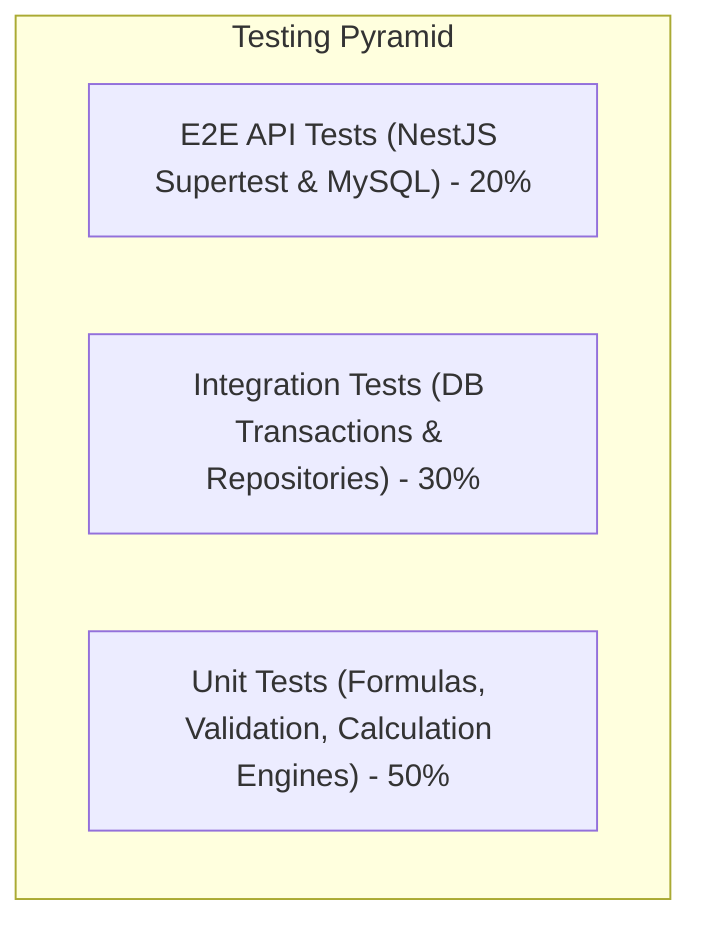

# Dairy Farm Management System - Test Strategy & Verification Plan

## 1. Testing Philosophy & Non-Negotiable Standards

In accordance with core project directives:
1. **Verifiable Truth:** Tests are never marked as "passed" unless executed and validated via terminal test runners (`jest`, `flutter test`).
2. **ACID Transaction Verification:** Every critical multi-step workflow (e.g. BMC intake, batch processing, packaging material deduction) must be validated with integration tests proving rollback on failure.
3. **Form State Integrity:** Every UI form must possess automated verification for:
   - Client-side validation errors (empty required fields, out-of-range numerical values).
   - Loading/in-flight submission state (disabled submit button, spinner).
   - Server error presentation (bad request, server offline, 500 error banner).
   - Successful submission and ledger refresh.

---

## 2. Test Classification & Coverage Targets

### 2.1 Backend Unit Tests
* **Feed Calculation Engine:**
  - Verify formula: $\min(1.0 + (\text{yield} \times 0.4), 8.0)$.
  - Test zero yield, boundary yields (e.g. 17.5 L $\to$ 8.0 kg), and cap enforcement (e.g. 30 L $\to$ 8.0 kg).
* **Daily Farm Milk Costing Engine:**
  - Test division by zero: When eligible milk is 0, status must return `Incomplete` and cost per litre `null`.
  - Test exclusion of withheld milk: If cow produced 10 L eligible and 5 L withheld, denominator must strictly equal 10 L.
* **Overhead Allocation Engine:**
  - Shared daily production electricity and labor allocated proportionately by BMC milk consumed.
  - Verify rounding to 2 decimal places with zero residual imbalance.
* **Employee Payroll Allocation:**
  - Verify daily rate formula: $\text{monthly\_salary} \div 30$.
  - Verify 50/50 split of management salary between Farm and Production.

### 2.2 Backend Integration & Transaction Tests
* **BMC Intake & Tank Balance Transaction:**
  - Test: Insert intake with decision `ACCEPTED` $\to$ verify tank ledger increments.
  - Test: Insert intake with decision `REJECTED` $\to$ verify tank ledger unchanged; rejected log created.
  - Test: Tank capacity breach: Intake exceeding 2,000 L capacity must fail with transaction rollback.
* **Production Batch Deduction Transaction:**
  - Test: Batch consuming 100 L BMC milk and 2 kg LPG. If LPG stock has only 1 kg, the entire batch creation must fail and BMC milk must not be deducted.
* **Packaging Run Ledger Transaction:**
  - Test: Packaging 100 L milk into 200 packs of 0.5 L. Verify bulk batch balance drops by 100 L and packaging stock drops by 200 units in a single atomic transaction.

### 2.3 Role-Based Authorization (RBAC) E2E Tests
Using `supertest` with simulated JWT bearer tokens across all 11 roles:
* `MILKING_STAFF` cannot access `/api/v1/expenses` (must return `403 Forbidden`).
* `STOREKEEPER` cannot mutate `/api/v1/herd` (must return `403 Forbidden`).
* `ACCOUNTANT` has read-only access to `/api/v1/electricity` and full write to `/api/v1/payments`.
* `FARM_OWNER` has full unrestricted access across all 24 modules.

### 2.4 Mobile Flutter Widget & Integration Tests
* **Responsive Layout Tests:**
  - Render screens on virtual screen sizes: Compact Phone (320x640), Standard Phone (390x844), Tablet (800x1280).
  - Assert zero render overflow errors (`RenderFlex overflowed`).
* **Offline & Connectivity Tests:**
  - Simulate network timeout on `POST /api/v1/milking`.
  - Verify user sees clear offline/retry alert banner without crashing or losing form inputs.
